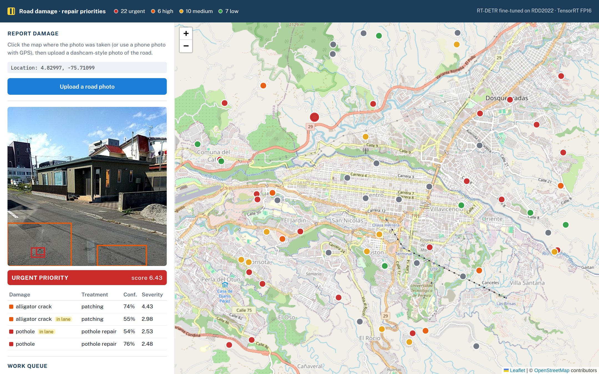
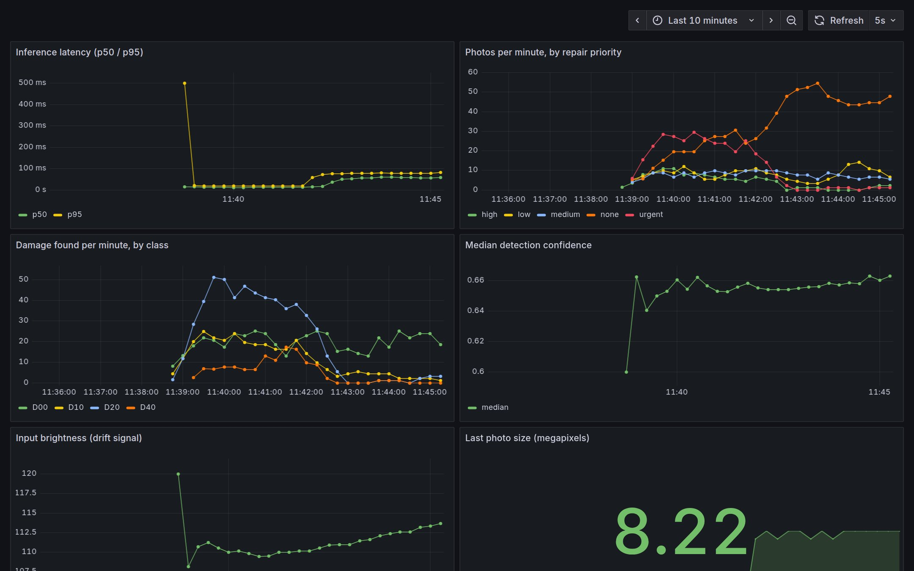

# road-damage-colombia

**A road damage detector that knows where it stops working.** RT-DETR, the first real-time transformer detector,
fine-tuned on road photos from four countries and compared with YOLO on equal terms; a test of what happens in a
country it has never seen; each photo turned into a repair priority on a map of Pereira; and the model exported to
TensorRT, served, monitored and gated like a production system.



## The paper, and what I added

**DETRs Beat YOLOs on Real-time Object Detection** (Zhao et al., Baidu, CVPR 2024,
[arXiv:2304.08069](https://arxiv.org/abs/2304.08069)). YOLO detectors are the real-time standard, but they need
non-maximum suppression (NMS) to remove duplicate boxes, which costs time and depends on thresholds. RT-DETR is a
DETR-style transformer that predicts each object once, with no NMS, and on COCO it beats YOLOs of the same size in both
accuracy and speed.

I tested that claim on a different domain, road damage, and added:

1. **A fair comparison:** RT-DETR-L against YOLO11m, same Ultralytics pipeline, data, epochs and augmentations, on
   RDD2022 (photos from Japan, India, Czech Republic and the United States; four damage classes).
2. **The cross-country question:** a model trained only on Japan, evaluated everywhere; and Norway kept out of
   training entirely, as a stand-in for a country the model has never seen. Colombia is one.
3. **From detection to decision:** each damage gets a severity (class, size, whether it is in the lane, confidence),
   each photo a repair priority and treatment, and the reports go onto a map as a work queue.
4. **Production engineering:** ONNX and TensorRT FP16 exports measured for speed and accuracy, a FastAPI service with
   Prometheus metrics, a Grafana dashboard, an MLflow quality gate with model registry, and Jenkins.

## What came out

**RT-DETR beats YOLO in every country**, by 5 to 8.4 points of mAP50 with the same data and training
([results/detection](results/detection)):

| test mAP50 | Japan | India | Czech | United States | Norway (never seen) |
|---|---:|---:|---:|---:|---:|
| **RT-DETR-L, 4 countries** | **0.573** | **0.390** | **0.365** | **0.611** | **0.158** |
| YOLO11m, 4 countries | 0.502 | 0.319 | 0.281 | 0.560 | 0.108 |
| YOLO11m, Japan only | 0.491 | 0.069 | 0.171 | 0.418 | 0.080 |

**A model from one country barely transfers.** Trained on Japan, YOLO matches the 4-country model at home and falls to
0.069 in India. **And no model is ready for a country it hasn't seen:** in Norway all of them drop to 0.08–0.16.
Before using any of this on Colombian roads, it needs labelled Colombian photos.

**Deployed, RT-DETR is both accurate and fast** ([results/serving](results/serving)): exported to TensorRT FP16 it runs
at 10.5 ms per image (95 FPS) on an RTX 4060, 3.6x faster than in PyTorch, with the same mAP. YOLO11m in TensorRT is
faster still (8.0 ms) but 9 points less accurate. The NMS-free design does what it says (0.15 ms of post-processing
against 0.5–0.8 ms for YOLO's NMS), but in PyTorch RT-DETR's heavier network makes it slower end to end; the
advantage appears once it is compiled.

**Monitoring catches the unseen country.** Switching the input stream from Japanese to Norwegian photos shows up on
the dashboard within a minute: photos with no damage found jump, alligator cracks vanish, latency rises with the
larger images, and the input brightness and size signals move.



## How it works

```
RDD2022 (Figshare, CC BY 4.0) -> VOC to YOLO labels, 70/15/15 per country
  -> RT-DETR-L / YOLO11m fine-tuned (Ultralytics, 20 epochs, 640 px)
  -> evaluate per country -> export ONNX / TensorRT FP16 -> quality gate -> MLflow registry
  -> FastAPI /detect (TensorRT engine, confidence 0.5 = F1-optimal on validation)
       -> severity per damage, priority per photo -> SQLite reports -> Next.js map
       -> /metrics -> Prometheus -> Grafana
```

- **Domain** (`domain/damage.py`): plain Python, no model. Severity = class weight x size x in-lane x confidence; the
  photo's priority is its worst damage plus a little for each other one. The weights are a stated policy for a city to
  tune, not a measurement. Repair cost is computed only from unit prices a maintenance office supplies: no made-up
  numbers.
- **Next.js + Leaflet map** of Pereira: click where the photo was taken, upload it, see the boxes, the priority and the
  treatment; the report joins the work queue, worst first.
- **Prometheus + Grafana** (`monitoring/`): latency p50/p95, photos per priority, damage per class, median confidence,
  and two cheap drift signals (input brightness and resolution).
- **Quality gate** (`scripts/quality_gate.py`): evaluates on Japan and on unseen Norway and times inference; it logs
  to MLflow and registers the model only if it passes (`quality_gate.json`).
- **Jenkins:** lint, tests, web build, the model gate on the GPU, and the Docker image (API on CPU with the ONNX
  export).
- **Training on a shared GPU:** the same card drives the desktop, so training caps its VRAM (`train.py --vram`) and
  can resume a crashed run.

## Run it

```bash
uv sync --group export --group mlops
# RDD2022 from Figshare (article 21431547, 13.3 GB) into data/raw/RDD2022.zip, then:
./run.sh prepare
./run.sh train               # ~7 h on an RTX 4060 for the three models
./run.sh evaluate
./run.sh export              # ONNX + TensorRT FP16 into data/models/
./run.sh gate                # MLflow quality gate and registry
./run.sh monitoring          # Prometheus :9090, Grafana :3001
./run.sh api                 # http://localhost:8000
./run.sh web                 # http://localhost:3000
./run.sh test
```

## What didn't work, and what to keep in mind

- **No Colombian photos yet.** The question this project really asks is "does it work in Pereira?", and the honest
  answer from Norway is "not without local data". Labelling a few hundred Colombian photos is the next step.
- **RT-DETR crashed twice:** once out of memory when I ran another CUDA job next to it, and once by filling the card
  that also drives the screen, which froze the desktop. Training now caps its VRAM and resumes from the last epoch.
- **TensorRT 11 dropped the FP16 builder flag** and needs NVIDIA ModelOpt to bake precision into the graph; TensorRT
  10 builds FP16 engines directly. PyTorch here uses CUDA 13, so the CUDA 13 builds of TensorRT were needed too.
- **YOLO lost 2 points of mAP when exported**, and not because of FP16: ONNX FP32 loses the same. The export takes a
  fixed 640x640 square while PyTorch validates YOLO on rectangular letterboxed batches. RT-DETR always uses the square.
- **Ultralytics' default confidence (0.25) over-flags damage:** at that threshold half the photos came out "urgent".
  The F1-optimal threshold on validation is 0.51 (mean F1 0.60 against 0.43), and that is what the API serves.
- **MLflow 3 only registers flavoured models**, so the gate registers the weights file as a model version directly.
- **Map locations are illustrative:** the demo reports are RDD2022 test photos from Japan placed around Pereira, to
  show the workflow.

## Credits and licenses

- Data: RDD2022 (Arya, Maeda, Ghosh, Toshniwal, Sekimoto et al., *RDD2022: A multi-national image dataset for
  automatic Road Damage Detection*, 2022; Figshare, CC BY 4.0). Not redistributed here.
- Zhao, Lv, Xu, Wei, Wang, Dang, Liu & Chen, *DETRs Beat YOLOs on Real-time Object Detection*, CVPR 2024.
- Ultralytics (AGPL-3.0), so this repository is AGPL-3.0 too. Map data © OpenStreetMap contributors.
